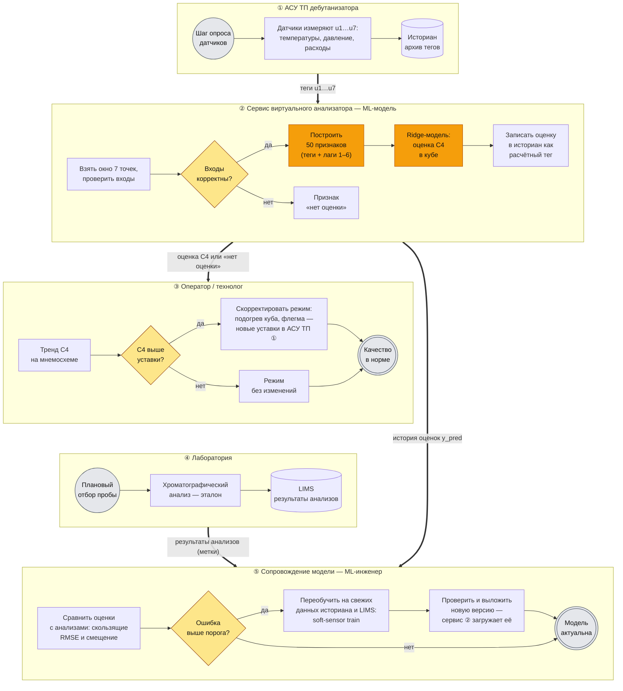

# Место модели в технологическом процессе

Схема показывает, как виртуальный анализатор встроен в контроль качества
на дебутанизаторе: откуда берёт данные, кому отдаёт результат и как
поддерживается его точность. Сама модель описана в
[model_card.md](model_card.md).

## Схема процесса (BPMN)

Каждая дорожка (lane) — участник процесса, номер ①–⑤ — порядок
появления в процессе. Обозначения BPMN: кружок — событие начала,
двойной кружок — событие завершения, прямоугольник — задача, ромб —
шлюз (развилка), цилиндр — хранилище данных. Тонкие стрелки — поток
управления внутри дорожки, толстые — поток данных между участниками.
Задачи ML-модели выделены оранжевым.

Процесс состоит из двух контуров:

- **оперативный** (①→②→③) повторяется на каждом шаге опроса датчиков:
  теги → оценка модели → решение оператора. Он замыкается через
  объект управления: новые уставки оператора меняют режим колонны,
  и это видно на следующем шаге опроса;
- **контур поддержания точности** (④ + ②→⑤) срабатывает на каждый
  новый лабораторный анализ: оценки модели сверяются с эталоном, и при
  деградации модель переобучается. Новая версия загружается обратно
  в сервис ②.

Та же схема в виде изображения: [docs/model_bpmn.png](docs/model_bpmn.png).

### Что реализовано в репозитории, а что — организационная часть

| Шаг на схеме | Чем реализован |
|--------------|----------------|
| Проверить входы | `soft_sensor.data.validate_frame` |
| Построить признаки | `soft_sensor.features.build_features` |
| Оценка C4 моделью | `soft_sensor.predict.SoftSensor.predict`, CLI `soft-sensor predict` |
| Переобучить | `soft_sensor.train.run_training`, CLI `soft-sensor train` |
| Проверить новую версию | метрики в `models/metadata.json`, тесты и CI репозитория |
| Обмен с историаном и LIMS, мнемосхема, сравнение с анализами по расписанию | Интеграция на стороне предприятия (OPC UA / SQL-коннектор, планировщик); в репозитории не реализовано |

## Пояснения к схеме

### Какую задачу в процессе решает модель

Модель выдаёт **непрерывную оценку содержания бутана (C4) в кубовом
продукте** дебутанизатора — ключевого показателя качества разделения.

Без модели этот показатель известен только по анализам, которые приходят
редко и с задержкой. Между анализами оператор управляет колонной вслепую:
отклонение, начавшееся сразу после отбора пробы, обнаружится лишь
в следующем анализе, когда некондиционный продукт уже выработан.

Модель заполняет промежутки между анализами: на каждом шаге опроса
датчиков она даёт оценку, и оператор видит тенденцию сразу.

### Почему для этой задачи целесообразно использовать ML

- **Дорого и долго измерять напрямую.** Поточный хроматограф стоит
  дорого, требует обслуживания и тоже даёт результат с задержкой.
  Лабораторный анализ ещё медленнее и реже.
- **Нужные данные уже есть.** Температуры, давление и расходы колонны
  непрерывно пишутся в архив АСУ ТП, а анализы — в LIMS. Отдельные
  датчики не нужны, модели нужна только история.
- **Связь сложна для «ручной» формулы.** Качество зависит от нескольких
  взаимосвязанных параметров одновременно, каждый влияет со своим
  транспортным запаздыванием, есть нелинейность. Модель на физических
  принципах потребовала бы полного состава сырья и сложной калибровки.
  Регрессия на исторических данных находит эту зависимость автоматически:
  наша модель сама выделила запаздывания 4, 2 и 1 шаг для температуры
  6-й тарелки, температуры низа и флегмы (см.
  [model_card.md, раздел 7](model_card.md#7-количественный-анализ-quantitative-analyses)).
- **Результат проверяем.** Каждый новый анализ — готовая метка для
  контроля точности. Поэтому качество модели можно отслеживать
  непрерывно и переобучать её по факту, а не по расписанию.
- **Простая модель, понятный эффект.** Выбранная Ridge-регрессия
  интерпретируема: технолог видит, какие параметры и с каким весом
  влияют на оценку. Это важно для доверия на производстве.

### Какие данные поступают на вход модели

Из историана АСУ ТП на каждом шаге — окно из 7 последних значений
(текущее и 6 предыдущих) по семи технологическим тегам:

| Тег | Параметр |
|-----|----------|
| `u1` | температура верха колонны |
| `u2` | давление верха |
| `u3` | расход флегмы |
| `u4` | расход на следующую установку |
| `u5` | температура 6-й тарелки |
| `u6`, `u7` | температура низа (два датчика) |

Из этого окна строятся 50 признаков: текущие значения, их лаги на 1–6
шагов и среднее двух датчиков низа. Перед этим входы проверяются;
при ошибке модель не выдаёт число, а выставляет признак «нет оценки».

Для **обучения и контроля** дополнительно используются результаты
анализов из LIMS — фактическое содержание C4, привязанное ко времени
отбора пробы.

### Как результат работы модели используется дальше

1. **Записывается в историан как расчётный тег.** Оценка хранится
   рядом с приборными измерениями и доступна всем системам предприятия.
2. **Оператор видит её на мнемосхеме** в виде тренда, помеченного
   как «расчётный». Если оценка превышает уставку, оператор заранее
   корректирует режим: увеличивает подогрев куба или меняет расход
   флегмы, не дожидаясь анализа. Решение остаётся за человеком; модель
   выступает советчиком.
3. **Сравнивается с каждым новым анализом.** Скользящие RMSE и
   смещение показывают, не деградировала ли модель. Устойчивое
   расхождение означает либо дрейф процесса (повод переобучить модель
   на свежих данных), либо неисправность датчика или анализатора
   (повод для проверки).
4. **Перспектива:** после валидации на реальных данных оценку можно
   подать в систему усовершенствованного управления (APC) как
   регулируемую величину — с ограничением диапазона и резервным режимом
   на случай признака «нет оценки».

**Итоговый эффект для процесса:** меньше некондиционного продукта
(отклонения ловятся раньше) и меньше перерасхода энергии (колонну не
нужно держать с запасом «на всякий случай» между анализами).
