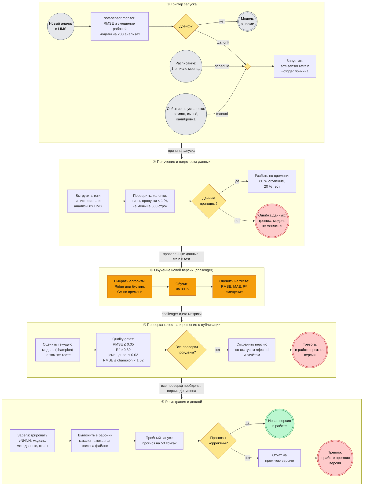

# Автоматическое переобучение модели

Процесс поддерживает точность виртуального анализатора, когда меняется
сам процесс на колонне: загрязняются тарелки, меняется сырьё, дрейфуют
датчики. Ниже описан путь от триггера до выкладки новой версии: какие
проверки проходит новая модель и при каких условиях она попадает
в эксплуатацию. Процесс реализован в коде репозитория и проверен
тестами — по каждому этапу указано, где именно.

Связанные документы: [model_card.md](model_card.md) — описание модели;
[Model_BPMN.md](Model_BPMN.md) — место модели в технологическом процессе
(дорожка ⑤ «Сопровождение модели» там — это и есть процесс,
раскрытый здесь подробно).

## Схема процесса (BPMN)

Дорожки ①–⑤ — этапы процесса сверху вниз. Обозначения BPMN: кружок —
событие начала, двойной кружок — событие завершения (зелёный — новая
версия в работе, красный — неуспех и тревога), прямоугольник — задача,
ромб — шлюз (развилка). Пустой ромб в дорожке ① — объединяющий шлюз:
процесс запускается любым из трёх триггеров. Толстые стрелки — что
передаётся на следующий этап. Обучение выделено оранжевым.



Та же схема в виде изображения:
[docs/model_retrain_bpmn.png](docs/model_retrain_bpmn.png).

## Этапы процесса

| № | Этап | Что происходит | Результат → следующему шагу | Где в коде |
|---|------|----------------|-----------------------------|------------|
| 1 | **Триггер** | Срабатывает один из трёх триггеров (таблица ниже). Причина фиксируется и попадает в отчёт | Команда `soft-sensor retrain --trigger <drift\|schedule\|manual>` | `retrain.check_drift`, CLI `monitor`; `.github/workflows/retrain.yml` |
| 2 | **Получение данных** | Выгрузка тегов u1…u7 из историана и результатов анализов из LIMS. Каждый анализ привязывается к моменту отбора пробы | CSV со свежими тегами и метками `y` | `data.load_dataset`; на предприятии — коннектор к историану и LIMS |
| 3 | **Подготовка данных** | Проверка схемы, типов, доли пропусков ≤ 1 %, объёма ≥ 500 строк; заполнение одиночных пропусков; разбиение по времени 80/20 без перемешивания | Проверенные train и test. Тест дополнен 6 точками истории для лагов | `data.validate_frame`, `data.time_split` |
| 4 | **Обучение** | Выбор алгоритма (Ridge или бустинг) по скользящей кросс-валидации, обучение на train, расчёт метрик на test | Новая версия (challenger) и её метрики: RMSE, MAE, R², смещение | `train.fit_model`, `model.select_model` |
| 5 | **Проверка качества** | Текущая рабочая модель (champion) оценивается на **том же** тесте. Затем четыре проверки (quality gates, ниже) | Список проверок со статусами OK/FAIL | `retrain.evaluate_gates` |
| 6 | **Решение о публикации** | Публикуется, только если пройдены **все** проверки. Иначе — отказ | «Допущена» → этап 7; «отклонена» → версия сохраняется для аудита, тревога | `retrain.run_retrain` |
| 7 | **Регистрация** | Версия получает номер vNNNN и сохраняется в реестр вместе с метаданными и отчётом — **в том числе отклонённая** | Номер версии и артефакт в реестре | `registry.ModelRegistry.register`, `write_report` |
| 8 | **Деплой** | Артефакт копируется в рабочий каталог через временную папку и атомарную замену, чтобы сервис не прочитал файл наполовину. Затем пробный запуск: прогноз на 50 последних точках | «Новая версия в работе» или откат | `registry.promote`, `retrain.smoke_test` |

### Триггеры запуска

| Триггер | Когда срабатывает | Зачем |
|---------|-------------------|-------|
| **drift** — деградация качества | `soft-sensor monitor` на последних 200 анализах: RMSE рабочей модели больше эталонного (из `metadata.json`) в 1.5 раза **или** \|смещение\| > 0.02. Код завершения 3 | Главный триггер: процесс изменился, модель устарела |
| **schedule** — по расписанию | 1-го числа каждого месяца (`cron` в `retrain.yml`) | Медленный дрейф, который не дотягивает до порога мониторинга, плюс накопление новых данных |
| **manual** — событие на установке | Технолог или ML-инженер запускает вручную (кнопка Run workflow) после ремонта колонны, смены сырья, перекалибровки датчиков | Известное изменение процесса — не ждать, пока его заметит мониторинг |

### Проверки качества (quality gates)

| Проверка | Порог | Почему именно так |
|----------|-------|-------------------|
| RMSE на тесте | ≤ 0.05 | Абсолютная пригодность: ошибка заметно меньше разброса цели (ст. откл. ≈ 0.12) |
| R² на тесте | ≥ 0.80 | **Санитарный** порог, не главный. R² занижается, когда цель на тестовом отрезке почти не меняется. При пороге 0.90 процесс отклонил модель, которая была вдвое точнее рабочей (RMSE 0.026 против 0.048, но R² = 0.84 из-за «спокойного» теста) |
| \|Смещение\| | ≤ 0.02 | Систематическое завышение или занижение опаснее случайной ошибки: оператор будет корректировать режим не туда |
| Не хуже текущей | RMSE ≤ RMSE champion × 1.02 | Обе модели сравниваются на одних и тех же свежих данных. Допуск 2 % позволяет обновить модель на более свежих данных при равном качестве, но не пропускает ухудшение |

Пороги задаются в `configs/train.yaml` (раздел `retrain`) и проверяются
схемой pydantic.

## При каких условиях модель попадает в эксплуатацию

Новая версия становится рабочей, только если выполнены **все** условия:

1. Свежие данные прошли проверку: все колонки на месте, пропусков ≤ 1 %,
   строк ≥ 500.
2. Пройдены все четыре quality gates, включая сравнение с текущей
   моделью на тех же данных.
3. Выложенная модель прошла пробный запуск: загружается, прогнозы
   конечны (без NaN и inf) и лежат в диапазоне [−0.1, 1.1].

При нарушении любого условия рабочей остаётся прежняя версия.

## Действия при неуспешном прохождении проверок

| Что пошло не так | Что делает процесс | Что в работе | Сигнал |
|------------------|--------------------|--------------|--------|
| Данные не прошли проверку или их мало | Останов до обучения, новая версия не создаётся | Прежняя версия | Код 1, красный прогон, сообщение «ОШИБКА ДАННЫХ» |
| Не пройдены quality gates | Версия сохраняется в реестр со статусом `rejected` и отчётом о том, какие проверки не пройдены | Прежняя версия | Код 2, красный прогон |
| Не пройден пробный запуск | Автоматический откат на предыдущую выложенную версию | Прежняя версия | Код 4, красный прогон |
| Сбой пробного запуска при первой выкладке (откатываться некуда) | Сломанная модель снимается с работы | Модели нет — сервис выдаёт «нет оценки», оператор опирается на анализы | Код 4 |
| Проблема обнаружена уже в эксплуатации | Ручной откат: `soft-sensor rollback` | Предыдущая версия | — |

Красный прогон GitHub Actions автоматически присылает владельцу
репозитория письмо — в демо это и есть «тревога». На предприятии сюда
подключается уведомление дежурному инженеру. Отчёт `report.json`
с причиной отказа хранится в реестре рядом с версией.

## Как это выглядит на практике

Прогон на данных, где режим колонны сместился (`--regime-shift 0.5`):

| Шаг | Команда | Результат |
|-----|---------|-----------|
| Первая версия | `retrain --trigger initial` | RMSE 0.026, все проверки OK → **v0001 в работе** |
| Процесс сместился | `monitor` | RMSE 0.062 > 1.5 × 0.026, смещение −0.045 → **дрейф**, код 3 |
| Переобучение | `retrain --trigger drift` | Новая RMSE 0.027 против 0.061 у текущей → **v0002 в работе** |
| Контроль | `monitor` | RMSE 0.028 → качество в норме |
| Плановое на новой выгрузке | `retrain --trigger schedule` | Новая RMSE 0.034, текущая 0.021: проверка «не хуже текущей» не пройдена → **отклонена**, в работе v0002 |
| Мало данных | `retrain` (300 строк) | «данных 300 строк, нужно минимум 500» → код 1, модель не изменена |
| Ручной откат | `rollback` | В работе v0001 |

Пятая строка показывает, зачем нужно сравнение с текущей моделью:
формально новая версия проходит все абсолютные пороги, но на свежих
данных она хуже той, что уже работает, и выкладывать её нельзя.

Все эти ветки закреплены автотестами (`tests/test_retrain.py`,
`tests/test_registry.py`).

## Как запустить

```bash
# мониторинг: код 3 — нужно переобучение
poetry run soft-sensor monitor data/raw/debutanizer.csv --config configs/train.yaml

# переобучение с проверками и выкладкой
poetry run soft-sensor retrain --trigger drift --config configs/train.yaml

# откат на предыдущую версию
poetry run soft-sensor rollback --config configs/train.yaml
```

Автоматический запуск — workflow **Retrain** (`.github/workflows/retrain.yml`):
по расписанию раз в месяц или вручную во вкладке Actions → Retrain →
Run workflow. Итог прогона (вывод мониторинга, проверки, `report.json`)
виден в сводке прогона. Реестр версий и рабочая модель публикуются
артефактами прогона.

## Демо и эксплуатация на предприятии

| Элемент | В репозитории (демо) | На предприятии |
|---------|----------------------|----------------|
| Свежие данные | Синтетика со сдвигом режима | Выгрузка из историана АСУ ТП и LIMS |
| Текущая модель | Восстанавливается в начале прогона | Хранится постоянно |
| Реестр версий | `models/registry/` + артефакт прогона | MLflow Model Registry или сетевое хранилище |
| Деплой | Публикация артефакта прогона | Копирование на сервер сервиса и его перезапуск |
| Тревога | Письмо GitHub о красном прогоне | Уведомление дежурному инженеру |

Логика процесса — триггеры, проверки, решение, реестр, откат — одна
и та же: меняются только источник данных и место хранения.
